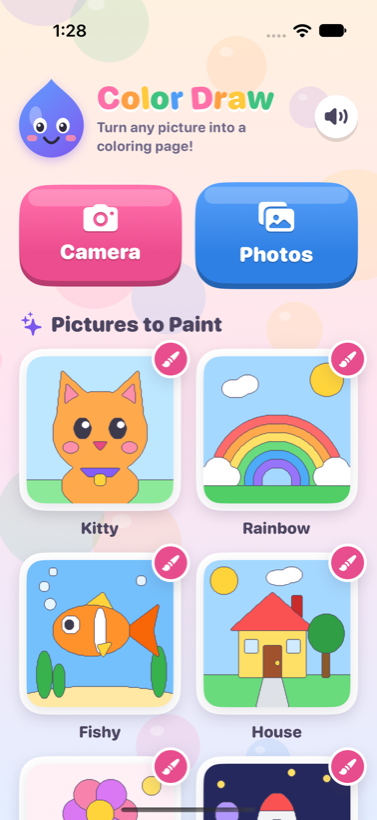
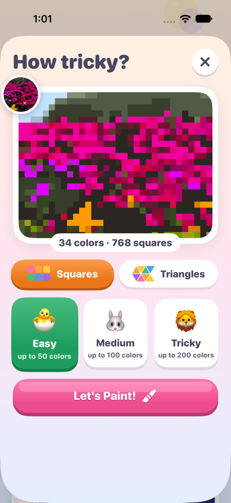
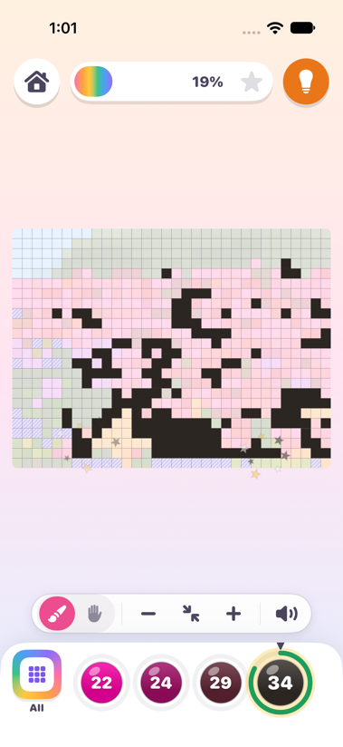
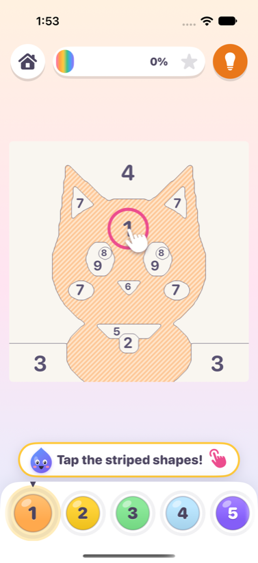
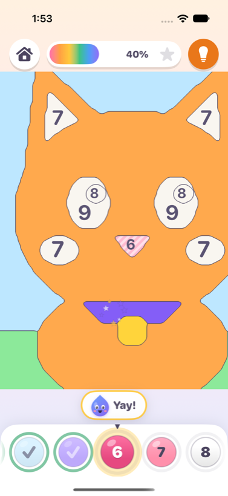
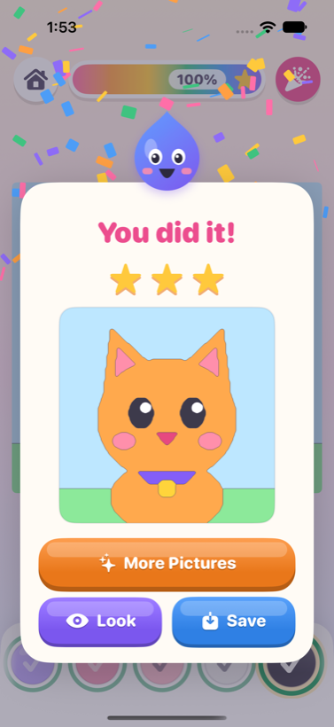

# Color Draw 🎨

A color-by-number iPhone and iPad game for kids. Snap a photo or pick one from your library,
and Color Draw turns it into a numbered mosaic of little squares or triangles. Each number is a
paint color, and little fingers tap or swipe across the tiles to fill them in.

<p>
  
  
  
  
  
  
</p>

## What kids can do

- **Use any picture**: take a photo with the camera, pick one from Photos, or start with one of
  six built-in drawings (kitty, rainbow, fish, house, flower, rocket).
- **Photos become mosaics**: a grid of **squares** (like pixel art) or of **triangles** (like
  low-poly art), each tile a shape of its own. Tile edges stay perfectly crisp, so faces stay
  recognizable, and neighboring tiles often share a color, so one swipe paints a whole run of
  them. Painted tiles join up seamlessly, with no grid lines, so a finished picture is clean,
  sharp color.
- **Choose how tricky**, with a live preview of the finished picture:

  | Level | Colors (at most) | Tiles on the long side | Tiles in a 3:2 photo | Made for |
  |---|---|---|---|---|
  | 🐣 Easy | 50 | 32 | about 700 | about 5 years old |
  | 🐰 Medium | 100 | 56 | about 2,100 | in between |
  | 🦁 Tricky | 200 | 80 | about 4,300 | about 8 years old |

  The color numbers are limits: a colorful photo uses up to that many paints, while a photo
  with fewer distinct colors gets fewer. Triangles come in about the same number as squares.
- **Paint by number**: pick a paint pot from the tray at the bottom. Every shape that takes that
  color is striped in a light tint of it, so kids can see where to paint. Tap a shape, or drag a
  finger across many shapes at once. Only the right color sticks, so a picture can't be spoiled.
  In small pictures a wrong tap wiggles the paint pot that's needed, and tapping the same shape
  again hands that pot over.
- **Find any of up to 200 colors quickly**: big photo puzzles don't make kids scroll through
  pots.
  - **Tap a shape to pick up its paint**, then tap again to paint it.
  - The tray shows the paint in hand plus the colors whose numbers are readable near the middle
    of the screen, as many as fit. It stays still while the picture moves.
  - The rainbow **All** tile opens a color chart: ten pots per row (1–10, 11–20, …) like a
    school hundreds chart, in pages of 50 with color-bar tabs. Kids who can read the number can
    switch to a big keypad and just type it.
  - Picking a color whose shapes are off screen zooms to one of them. Finishing a color hands
    over one nearby.
  - Unpainted shapes show a pale tint of their color, so the photo is recognizable before
    painting.
  - Cheers come at ¼, ½ and ¾ of the way.

  Pictures with 12 colors or fewer, like the built-in drawings, keep a simple row of pots and a
  white page.
- **Zoom so numbers are clear**: pinch with two fingers or use the **+ / − / fit** buttons.
  Numbers are drawn as vector text, so they stay sharp at every zoom level. Tiny numbers
  appear as you zoom in. When zoomed in, a one-finger drag that paints nothing and isn't
  heading toward the chosen color moves the picture. Kids who can't manage two fingers can
  also switch from 🖌 to ✋, so every one-finger drag moves the picture.
- **Swipe to paint**: pick a color and sweep a finger across the picture. A round brush about
  as wide as a fingertip paints every shape of that color it touches, however fast the swipe,
  even if it starts on another color. A mosaic starts with the color that has the most tiles,
  so the first swipes paint big runs. The brush size lives in `PaintTouch.strokeRadius`
  (`ColorDraw/Paint/PaintCanvasView.swift`).
- **Get help**: a spoken tip and a pulsing shape show how to start. The 💡 button jumps to the
  next shape of the chosen color and makes it pulse. After a quiet spell it wiggles by itself,
  and if a child stays stuck it finds a shape for them.
- **Celebrate**: every paint stroke plays a xylophone note and makes sparkles. Finishing a color
  earns a cheer from Dotty the paint drop and moves on to the next color by itself. Finishing the
  picture brings confetti, three stars and a **Save to Photos** button.
- **Come back later**: paintings save automatically and show up under *My Paintings* with
  their progress. The 🎉 button on a finished painting brings back its celebration and its
  **Save** button. Grown-ups can delete a painting by long-pressing it.

Everything happens on the device. There's no network access, no accounts, no ads, no in-app
purchases and no buttons that lead out of the app. It respects VoiceOver, Dynamic Type and
Reduce Motion, and its sounds follow the silent switch.

## How a photo becomes a puzzle

The engine lives in [`Packages/ColorDrawKit`](Packages/ColorDrawKit) and is plain Swift and Core
Graphics, so it is unit-tested on the Mac.

1. **Lay out the tiles** (`Tiling.swift`): 32, 56 or 80 squares along the long side, or as many
   equilateral triangles of the same size. Panoramas are first cropped to at most 2:1, and the
   photo is trimmed a hair so the grid fits exactly. Each square is 8 working pixels wide.
2. **Smooth** the photo with an edge-preserving bilateral filter in CIE L\*a\*b\* space, which
   flattens texture and noise but keeps outlines.
3. **Pick the palette** (up to 50, 100 or 200 colors) with k-means++ in Lab space, merge colors
   that look the same, then give the palette a gentle "storybook" boost (brighter and more
   colorful). Flat-color artwork keeps its exact colors.
4. **Color the tiles** (`TiledPuzzleGenerator.swift`): every tile takes the color most of its
   pixels have, so a tile on an edge picks a side instead of becoming a muddy blend. A lone
   tile whose neighbors share a very similar color joins them, and colors used by only a tile
   or two merge into a similar neighbor, so there are fewer specks to hunt for and longer runs
   to swipe. Strongly different details, like a sparkle in an eye, stay.
5. **Number the tiles** at the center of the biggest circle inside each one. Every number is
   sized for the longest one, so single digits are as big as double digits and the grid looks
   even (only the half triangles at the edges get smaller numbers).
6. **Draw the tiles** straight from their geometry at about 2,000 pixels on the long side, with
   anti-aliased grid lines only on tiles that aren't painted yet. Painting, hit testing and
   lines all use this map, so what kids see is exactly what responds to their finger. Zoomed
   in, square tiles are shown pixel-sharp.
7. **Order the palette like a rainbow**, so the numbers run red, orange, yellow, green, blue,
   purple, then grays.

The built-in drawings use the engine's other mode, where shapes follow the picture's own
outlines: regions are found with connected components, regions too small to paint are folded
into a neighbor, numbers go at the deepest point of each region (an exact Euclidean distance
transform), and outlines are smoothed into cartoon-like curves by Gaussian voting on a map
scaled up about 10×. Photo puzzles made before mosaics keep working this way too.

## Project layout

```
ColorDraw.xcodeproj           Xcode project (iOS 17+, Swift 6)
ColorDraw/
  App/                        App entry point
  Home/                       Home screen: photo buttons, my paintings, built-in pictures
  Create/                     Shape and difficulty picker with live preview, camera picker
  Paint/                      Painting screen
    PaintSession.swift          Game state: selection, painting rules, cheers, saving
    PaintCanvasView.swift       UIKit zoomable canvas, gestures, sparkles
    NumbersLayer.swift          CATiledLayer that draws crisp numbers at any zoom
    PaletteBar.swift            The paint pots
    CelebrationView.swift       Confetti and "You did it!"
  Services/                   Saving, synthesized sounds, haptics, photo loading
  Theme/                      Colors, candy buttons, Dotty the mascot, bubble background
  Resources/                  Asset catalog (app icon)
ColorDrawUITests/             End-to-end UI tests that play the game
Packages/ColorDrawKit/        The engine (Swift package)
  Sources/ColorDrawKit/         Generator (mosaic tiles and outlined regions), rendering,
                                progress rules, storage
  Sources/puzzle-preview/       Mac tool that renders puzzles to PNG for tuning
  Tests/ColorDrawKitTests/      Unit tests
scripts/make-app-icon.swift   Draws the app icon
```

## Build and run

Requires Xcode 16 or newer. The project uses folder-synchronized groups.

1. Open `ColorDraw.xcodeproj`.
2. Pick the **ColorDraw** scheme and an iPhone or iPad simulator, then press **Run**.
3. To run on a real device, choose your team under *Signing & Capabilities* and set the
   `BUNDLE_ID_PREFIX` build setting (default `com.example`) to something of your own. From the
   command line:

   ```bash
   xcodebuild -project ColorDraw.xcodeproj -scheme ColorDraw -configuration Release \
     -destination 'id=<device UDID>' -allowProvisioningUpdates \
     DEVELOPMENT_TEAM=<team ID> BUNDLE_ID_PREFIX=com.yourname build
   xcrun devicectl device install app --device <device UDID> <path to ColorDraw.app>
   ```

The simulator has no camera, so use **Photos** there; the simulator ships with sample photos.

## Tests

Engine unit tests (fast, run on the Mac):

```bash
cd Packages/ColorDrawKit && swift test
```

Everything, including UI tests that paint a whole picture, from the repository root:

```bash
xcodebuild test -project ColorDraw.xcodeproj -scheme ColorDraw -destination 'platform=iOS Simulator,name=iPhone 17'
```

Set `TEST_RUNNER_SCREENSHOT_DIR=/some/folder` to also save a screenshot of each UI test step.

## Tuning the engine

`puzzle-preview` renders puzzles to PNG files: blank with numbers, partly painted, finished,
and a sheet comparing all three difficulties in squares and in triangles. It also prints how
many colors each puzzle has and how many tiles stand alone (no neighbor of their color).

```bash
cd Packages/ColorDrawKit
swift run -c release puzzle-preview /tmp/previews               # built-in pictures
swift run -c release puzzle-preview /tmp/previews ~/Pictures/*.jpg
TILES=32,56,80 swift run -c release puzzle-preview /tmp/previews ~/Pictures/*.jpg   # try other grid sizes
```

Difficulty presets live in `PuzzleSettings` (`PuzzleGenerator.swift`).

## App icon

```bash
swift scripts/make-app-icon.swift ColorDraw/Resources/Assets.xcassets/AppIcon.appiconset/AppIcon.png
```
